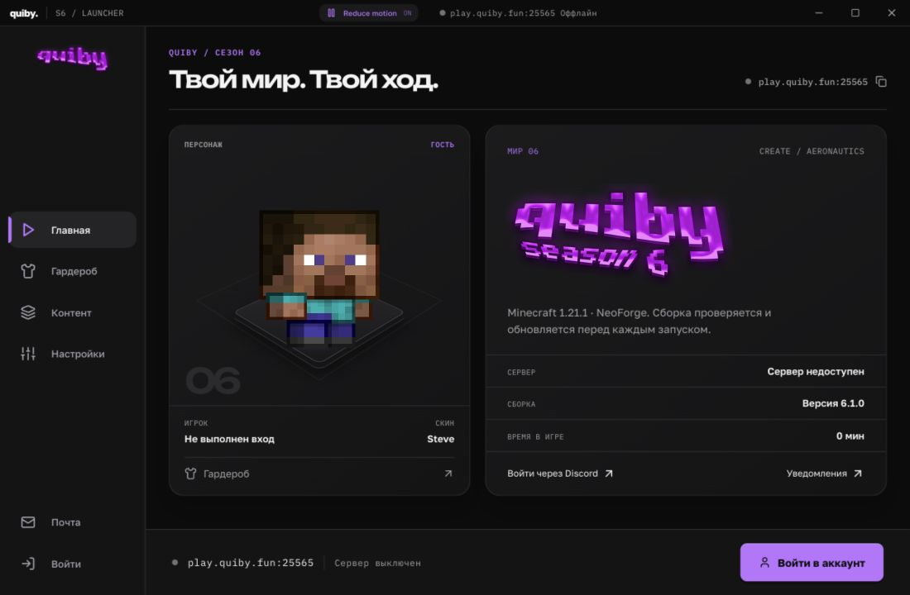
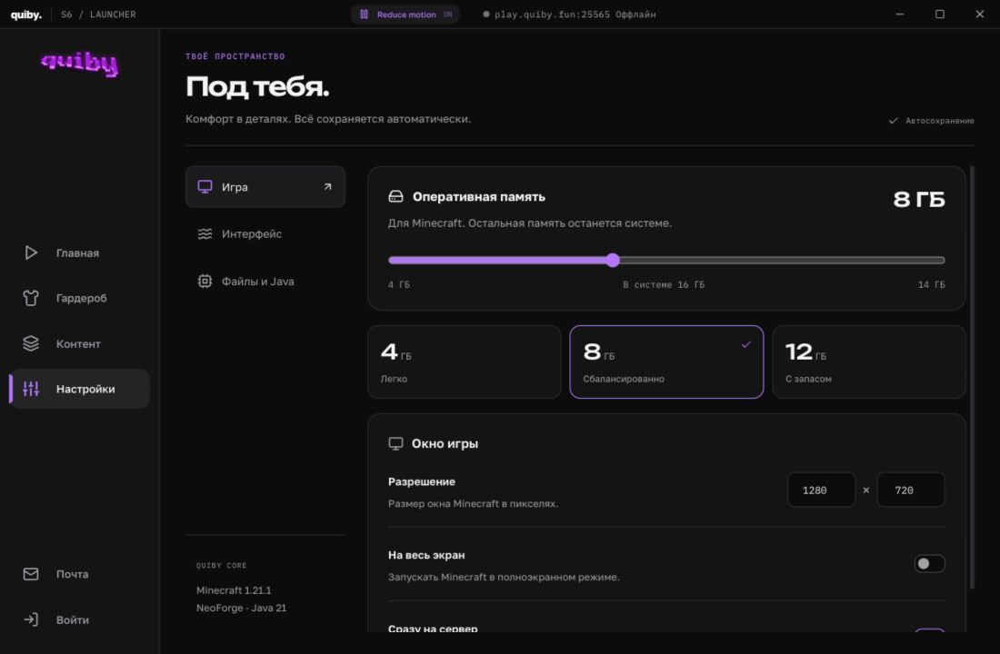
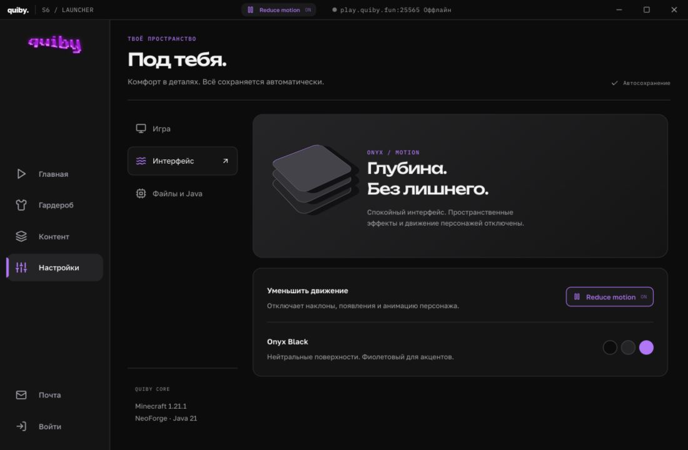
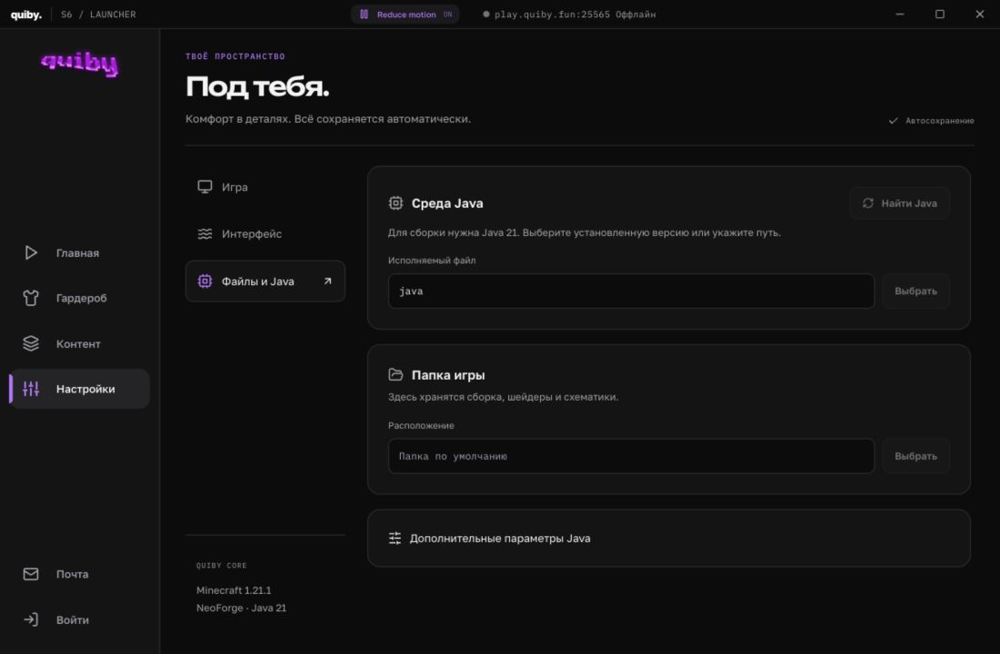
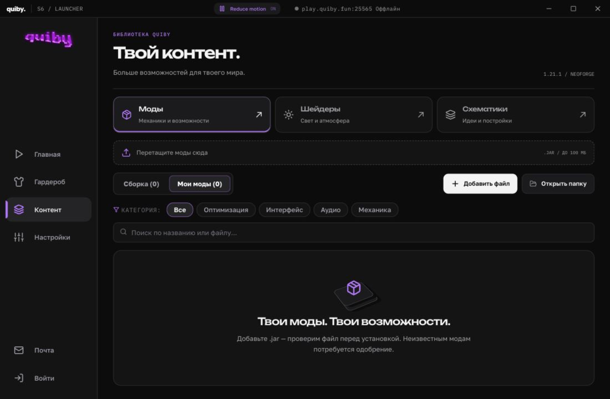
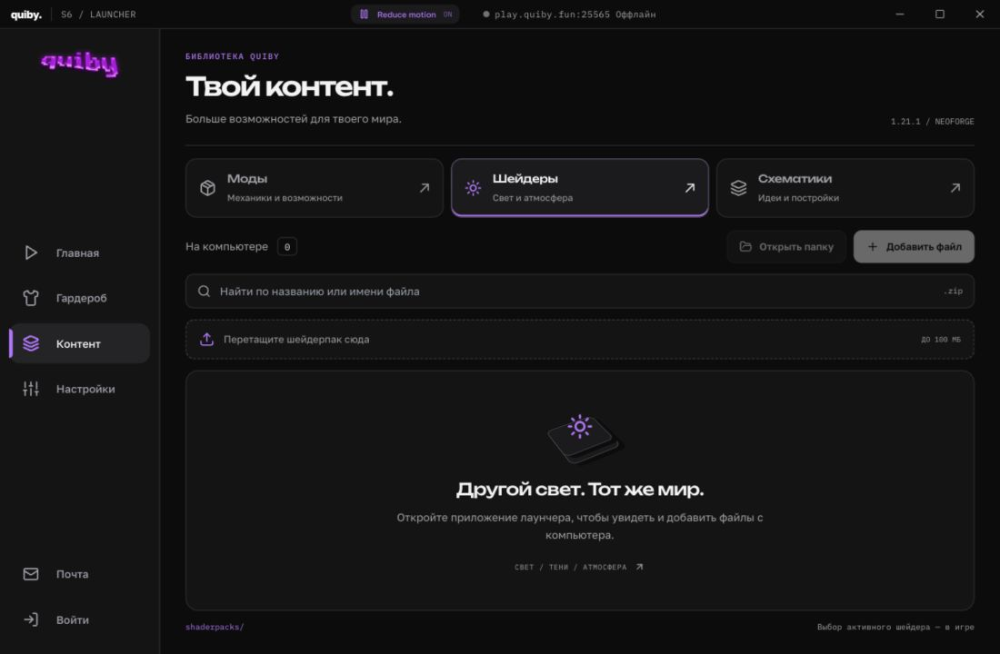
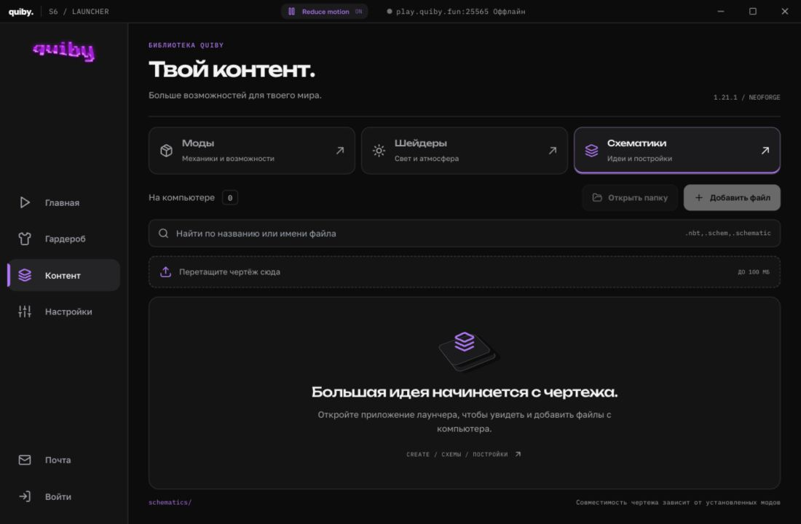
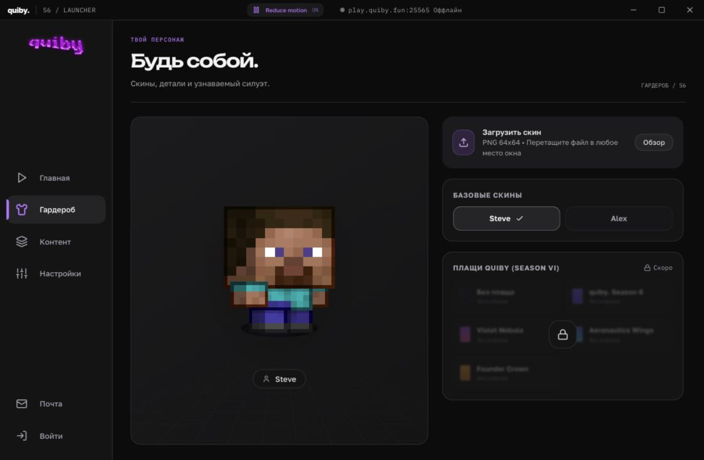
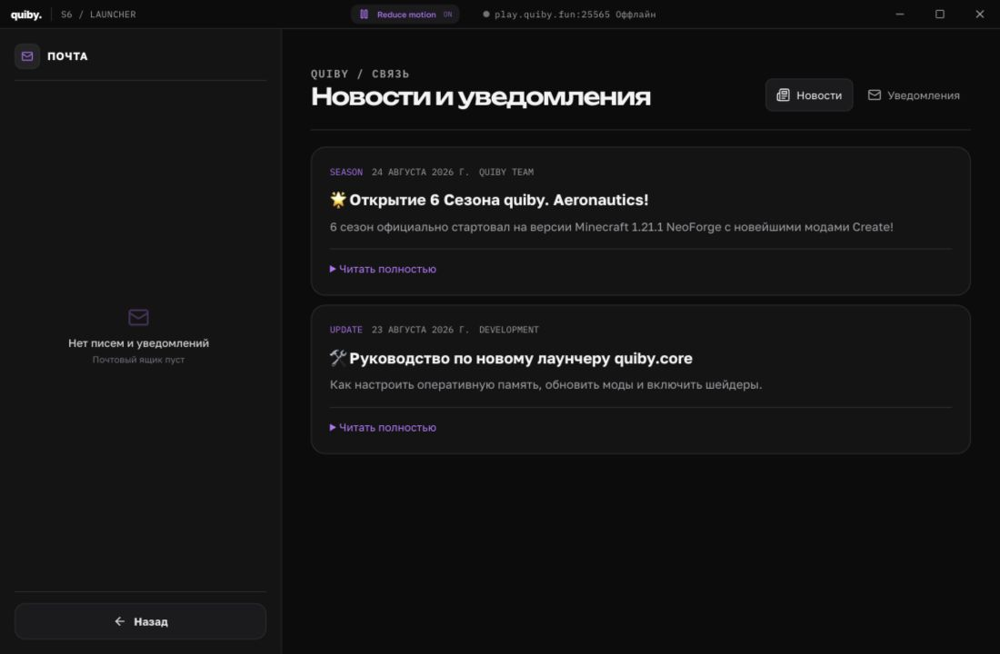

# quiby — обзор обновления интерфейса

25 сентября 2026 · Onyx Black / Unbounded / Motion

## Что изменилось

Широкая типографика, нейтральные чёрные поверхности, единые заголовки и действия. Фиолетовый используется для акцентов. Авторизация, главная, гардероб, настройки, контент и почта оформлены в общей системе.

На главной и странице входа — лёгкий наклон от курсора, перспектива и многослойные элементы. Настройки разделены на игру, интерфейс, файлы и Java. Для модов, шейдеров и схематик согласованы навигация, поиск, импорт и пустые состояния. В коллаж авторизации добавлены реальные новые экраны.

## Найдено и исправлено

| Область | Проблема | Изменение |
| --- | --- | --- |
| Шейдеры и схематики | Демонстрационные записи и изменения только в localStorage | Чтение папок игры, импорт файлов, удаление через системную корзину |
| Импорт файлов | Не было общего проверяемого пути импорта | Проверка типа библиотеки, имени, расширения, размера; запрет перезаписи существующего файла |
| Моды | В список сборки могли попадать другие файлы манифеста | Показываются только JAR из mods/ |
| Выбор контента | Выделенные моды сохраняли панель действий при смене категории | Выделение сбрасывается при переключении библиотеки |
| Настройки | Переключатели подключения могли расходиться | Синхронизированы настройки и панель запуска |
| Анимация персонажа | requestAnimationFrame опрашивал время между редкими кадрами | Таймер с задержкой текущего кадра, остановка в фоне и при Reduce motion |
| Гардероб | Вычислялся тип Alex, но рендер всегда получал Steve | Рендеру передаётся определённый тип модели |
| Уведомления | Скрытое уведомление оставалось в DOM, таймер зависел от нового callback родителя | Удаление по таймеру, стабильная ссылка на callback, простая анимация opacity/transform |
| Экран запуска | При ширине 980 px сетка переходила в одну обрезанную колонку | Постоянные две колонки для минимального окна лаунчера |
| Движение при запуске | Фоновое видео и программный smooth scroll не учитывали reduced motion | Видео приостанавливается, лог прокручивается без плавного движения |
| Отрисовка | Полноэкранные backdrop blur и анимация ширины индикатора | Нейтральные непрозрачные панели; прогресс через scaleX |

## Правила движения

- Кнопка **Reduce motion** всегда в шапке и продублирована в настройках.
- Выбор сохраняется. Системное prefers-reduced-motion имеет приоритет.
- При снижении движения отключены переходы, наклоны, анимации персонажей.
- При скрытом документе CSS-анимации приостанавливаются, таймеры кадров и видео останавливаются.
- Наклон вычисляется по событию курсора, без постоянного цикла.
- Новые библиотеки и WebGL не добавлялись. Реальные показатели FPS/энергопотребления на слабом ПК отдельно не измерялись.

## Проверка

- `npm test`: 10 тестов/тестовых файлов, ошибок нет, включая новые проверки реального импорта во временную папку, обхода путей, дубликатов и неподдерживаемых файлов.
- `npm run typecheck`: все workspaces прошли.
- `npm run build`: весь проект собран; после финальных изменений лаунчер собран повторно.
- В production preview проверены авторизация, главная, настройки, все библиотеки, гардероб, почта; компактные экраны — при 980×620.
- Проверены ручной Reduce motion, сохранение после перезагрузки, системный prefers-reduced-motion через эмуляцию; у анимаций/переходов длительность 0.
- В журнале браузера при проверке ошибок и предупреждений не было.
- Финальный renderer: JS около 311 KB / 100 KB gzip, CSS около 73 KB / 14 KB gzip. Шесть изображений для коллажа суммарно около 273 KB.

## Границы проверки

Скриншоты сняты в браузерном preview production-сборки. В нём файловые кнопки библиотек отключены: доступ к диску работает через Electron. Файловая логика проверена тестами, интеграция main/preload — типизацией и сборкой. Полный сценарий импорта через нативное окно Electron, Discord OAuth и запуск Minecraft в этом проходе не выполнялись.

Шейдерпак выбирается в настройках Minecraft. Совместимость схематики определяется установленными модами. Предыдущие проверки JAR и серверного одобрения модов сохранены; проверки лаунчера не являются защитой от всех способов читерства внутри игры.

## Скриншоты

### Авторизация

### Главная

### Настройки игры

### Движение и оформление

### Файлы и Java

### Моды

### Шейдеры

### Схематики

### Гардероб

### Почта

