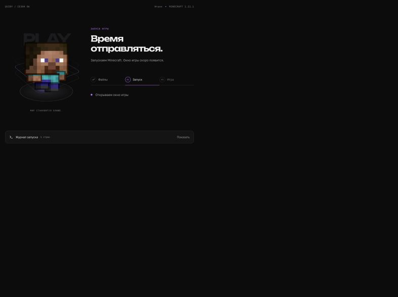

# Запуск игры и настройки

- Общие стили текстовых полей больше не перекрашивают checkbox. У включённого переключателя видны акцентный фон и тёмный маркер.
- Почта и сворачивание используют Unbounded 10px, как основная навигация.
- Обложка сборки: исходное изображение справа, статическое размытие и затемнение слева. Первый файл из папки сборки автоматически заменяет временный скриншот лаунчера.
- Запуск показывает реальные состояния Electron: подготовка файлов, запуск процесса, работающий Minecraft. Процент относится к текущему этапу загрузки. Состояние running означает запуск процесса, а не вход на сервер.
- Три рамки анимируются через transform; при Reduce motion анимации отключаются, в скрытом окне приостанавливаются. Журнал раскрывается по запросу и не перетягивает прокрутку, если пользователь читает старые строки.

Проверены три состояния компонента, журнал, переключатель, одинаковые вычисленные стили шрифтов и Reduce motion. Размеры окна: 1280×720 и 980×620. Для проверки состояний использовалась временная локальная страница, удалённая после проверки. Сам Minecraft в этой проверке не запускался.

