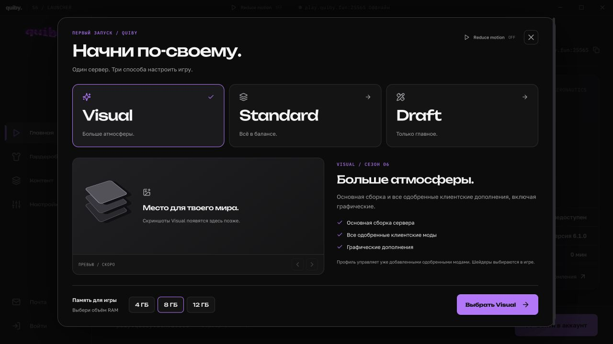
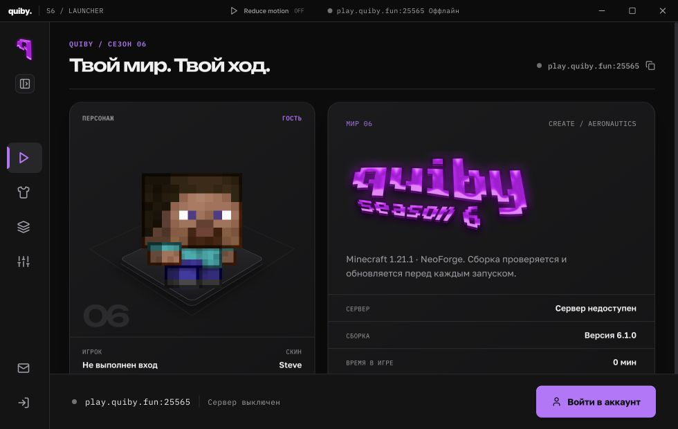
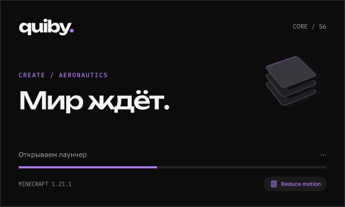
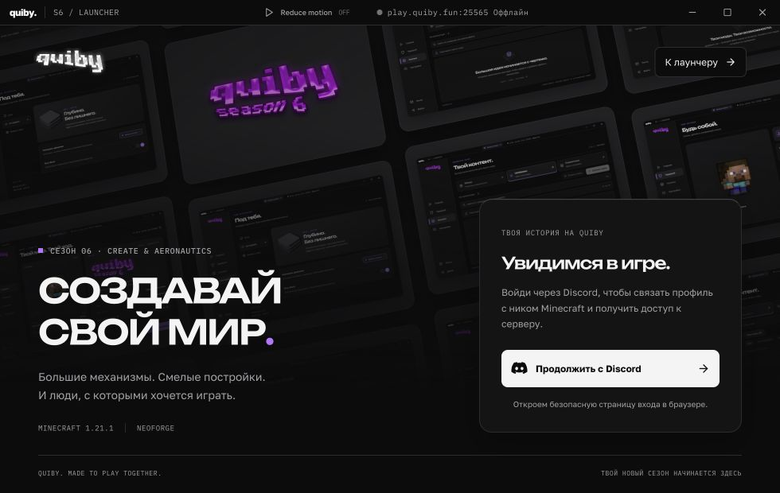

# quiby: первый запуск, меню и API модерации

## Интерфейс

- Auth: вместо реакции на мышь четыре медленных вертикальных потока карточек. CSS transform, циклы без шва, остановка при Reduce motion и скрытом окне.
- Меню: кнопка раскрытия/сворачивания, сохранение выбора; иконки и подсказки в компактном режиме. Почта раскрывается отдельно и возвращает исходную ширину.
- Широкая типографика: навигация, группы настроек, текущая сборка, карточки Visual / Standard / Draft, экран запуска.
- Первый запуск: выбор профиля, галерея с честным состоянием «скриншоты позже», память, работа с клавиатурой, модальная блокировка фона и возврат фокуса.
- Выбор сборки доступен повторно в настройках. Сохранение ожидает ответа Electron; при ошибке диалог не закрывается.
- Splash: новая композиция, реальная готовность главного окна вместо искусственного процента. Отдельный лёгкий React-экран без повторных запросов App.
- Reduce motion синхронизируется между окнами лаунчера через событие storage.

## Профили

| Профиль | Клиентские моды |
| --- | --- |
| Visual | Все уже добавленные одобренные |
| Standard | Одобренные, кроме категории graphics |
| Draft | Пользовательские дополнения отключены |

Все три варианта используют один основной серверный манифест. Никакие неизвестные или заблокированные моды выбором профиля не включаются. Галерея автоматически подхватывает файлы из [папки изображений](../apps/launcher/src/renderer/src/assets/builds/README.md) при сборке.

## Discord

Реализован [REST API](discord-mod-review-api.md) для отдельного бота: очередь с пагинацией, чтение заявки, одобрение/отклонение. Отдельный ключ, проверенная личность отправителя, аудит решения и защита от повторного противоречащего решения. Последнее решение по хешу остаётся приоритетным даже после очистки кеша и запоздалого ответа каталога.

Код самого Discord-бота здесь отсутствует. Для подключения ему нужны вызовы описанных методов и MOD_REVIEW_BOT_API_KEY из серверного окружения. Ключ в лаунчер не попадает.

## Проверено

- Все 12 тестов/тестовых файлов проходят. Новый HTTP-тест использует временную SQLite-базу: авторизация, подмена отправителя, повторная заявка, очереди, решение, конфликт, кеш и порядок решений.
- Проверка типов и сборка всех workspaces.
- Production preview: 980×620 и 1280×720, автоматический первый запуск, три варианта, клавиатура, применение профиля и памяти, повторное открытие из настроек, отсутствие повторного онбординга после завершения.
- Сворачивание меню, восстановление после перезагрузки, почта из компактного режима.
- Reduce motion в диалоге: transition 0s. Колонки в обычном режиме: четыре работающих CSS-анимации.
- Splash проверен в размере 500×300. Полный переход splash → main в отдельном production Electron не удалось однозначно наблюдать: инструмент выбирал уже открытое dev-окно. Запуск Minecraft и Discord-бота не выполнялся.
- Производительность на слабом ПК не измерялась. Новых зависимостей нет.

## Скриншоты

